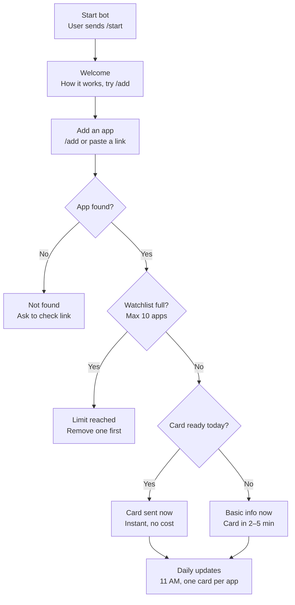
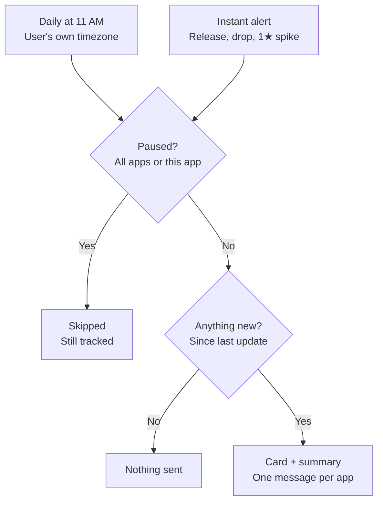

# StoreRating — Build Plan

## Goal

Build **StoreRating** (`@storeratingbot`), a free Telegram bot that watches Google Play apps and tells developers, PMs and founders how their apps and competitors are doing: rating changes, new releases, review complaint themes and sudden 1★ spikes.

Why: a resume-worthy project that proves scheduled data pipelines, LLM summarisation at scale, fan-out notifications and cost-aware architecture, with real users and real numbers.

Constraints:
- Free for users. No paid tier.
- Near-zero running cost. Only the Claude API is paid; everything else stays on free tiers.
- Must scale to ~1,000 users × ~9 apps without a cost or rate-limit cliff.
- Fixed Claude budget from day 1. The Bot spends up to the budget, never past it, and degrades gracefully instead of failing. A budget is a design input, not a risk: every guardrail below exists so the money goes to the Apps people actually watch.
- Store only what is useful. Raw reviews are processed and discarded.
- Store minimal user data: chat ID, timezone, settings, watchlist. No names or usernames.

Rejected approaches:
- **Resume-tailoring bot** — too many failure points in PDF generation, and little value beyond plain ChatGPT/Claude.
- **Per-user scraping and summarising** — cost grows with users. Work is done once per app and shared.
- **Storing raw reviews** — grows too fast for free DB tiers. Snapshots and summaries hold the long-term story.
- **Rendering cards or running the Daily Job in serverless functions** — scraping, Claude batches and Playwright rendering run too long and need a browser. They stay on GitHub Actions.
- **Cloudflare Workers, Pages and Access** — the Cloudflare connector cannot deploy and is deprecated. Vercel hosts the web parts instead: ayazqureshi.com already runs there and the Vercel connector can link the repo, deploy and read logs.
- **Separate image and text messages** — doubles Telegram volume. One photo with caption per app.
- **Paid tier with faster checks** — the bot stays free.
- **Calling `google-play-scraper` directly from job code** — the library is unofficial and breaks when Google changes the page. All store access goes through the Store Source contract so the library can be swapped in one place.
- **"Play" in the name** — "Google Play" is a Google trademark.

## Terms

- **Bot** — the Telegram bot `@storeratingbot`.
- **User** — a Telegram chat that has sent `/start` to the Bot.
- **Admin** — Ayaz; identified by `ADMIN_CHAT_ID`.
- **Admin Command** — `/stats`, `/budget`, `/setbudget`. Works only for the Admin.
- **Admin Check** — the single function `isAdmin(update)` in the Webhook Function. True only when `message.from.id` equals `ADMIN_CHAT_ID` and the chat type is `private`.
- **App** — a Google Play listing identified by its package name (e.g. `com.whatsapp`).
- **Watchlist** — the set of Apps a User follows. Maximum 10 Apps.
- **Watcher** — a User who has a given App in their Watchlist.
- **Web Project** — the Vercel project `storerating`, built from `web/` (Astro with the Vercel adapter). Holds the Webhook Function, the Stats API and the Dashboard. Deploys on every push to `main`.
- **Webhook Function** — the Vercel function at `/api/telegram` that receives Telegram updates and answers commands and button taps.
- **Admin Session** — a signed, httpOnly cookie valid for 12 hours, issued after a Telegram Login whose user ID equals `ADMIN_CHAT_ID`.
- **Bot Setup Workflow** — `.github/workflows/bot-setup.yml`, run on demand. Calls `setWebhook`, `setMyCommands` (public and Admin scope), `setMyDescription` and `setMyShortDescription` with repository secrets.
- **Daily Job** — the GitHub Actions workflow that fetches, summarises, renders and sends.
- **Store Source** — the contract for all store access: `get_listing(package)`, `get_reviews(package, since_id)`, `exists(package)`. Defined once in `contracts/`. No other code talks to a store directly.
- **Source Adapter** — one implementation of the Store Source. First adapter: `GooglePlayScraperAdapter` (JoMingyu `google-play-scraper`). Possible later adapters: the Node `google-play-scraper` through `google-play-api`, a paid scraping API, the official Play Developer API for Apps a User owns.
- **Active Source** — the Source Adapter selected by `STORE_SOURCE`. Changed without code edits.
- **Fallback Source** — the Source Adapter used when the Active Source fails for an App. Selected by `STORE_SOURCE_FALLBACK`. Optional.
- **Listing** — the normalised App data every Source Adapter returns: `store`, `package`, `name`, `developer`, `icon_url`, `version`, `rating`, `review_count`, `installs_tier`, `size`, `updated_at`, `release_notes`. Missing values are `null`, never adapter-specific.
- **Review** — the normalised review every Source Adapter returns: `id`, `stars`, `text`, `thumbs_up`, `app_version`, `created_at`. No reviewer name or avatar.
- **Lookup Adapter** — the TypeScript implementation of `exists` and `get_listing` used by the Webhook Function for `/add`. Returns the same Listing.
- **Contract Fixtures** — saved raw responses plus the expected Listing and Review JSON in `contracts/fixtures/`. Every Source Adapter and the Lookup Adapter must pass them.
- **Fetch** — one call to the Active Source for an App's Listing and new Reviews.
- **Snapshot** — one stored row of an App's listing data for one day.
- **Summary** — Claude's output for one App for one period: top 3 complaint themes and top 3 praise themes with rough shares.
- **Card** — the 1200×630 PNG image for one App for one period.
- **Update** — one Telegram message: a Card with a caption. Sent once per App per Watcher.
- **Daily Update**, **Monthly Report**, **Quarterly Report** — Updates for those periods.
- **Alert** — an Update sent outside the schedule because of an Alert Event.
- **Alert Event** — new version released, rating drop ≥ 0.1 within 7 days, 1★ share spike, or App removed from the store.
- **Digest Time** — the local time a User receives Daily Updates. Default 11:00, timezone default `Asia/Kolkata`.
- **Global Pause** — `users.paused = true`. No Updates or Alerts to that User.
- **App Pause** — `watchlist.paused = true`. No Updates or Alerts for that App to that User.
- **On-demand Run** — a one-off Daily Job run for Apps that have no Card for today, started by the Webhook Function through `repository_dispatch`.
- **New-App Quota** — the maximum number of On-demand Run Apps one User can trigger per day. Value: 5.
- **On-demand Budget** — the maximum number of On-demand Run Apps across all Users per day. Value: 200.
- **Action Limit** — the maximum number of add and remove actions one User can do per hour. Value: 20.
- **Monthly Budget** — the maximum Claude spend per calendar month. Value: $30. Set in two places that must match: the spend limit in the Anthropic Console, and `monthly_budget_usd` in the `config` table (seeded from `MONTHLY_BUDGET_USD`).
- **Daily Budget** — `MONTHLY_BUDGET_USD` ÷ days in the month. The Daily Job and On-demand Runs share it.
- **Spend Ledger** — the `spend` table. One row per Claude call with tokens and cost in USD.
- **Priority Order** — the order Apps get Summaries in: most Watchers first, then most new reviews.
- **Degrade Mode** — the state when today's spend reaches 80% of the Daily Budget. Remaining Apps get Updates from Snapshot data only (rating, version, counts) and no Summary.
- **Top-up Alert** — the Admin Telegram message sent when month-to-date spend reaches 70% of the Monthly Budget. Contains spent, remaining, days left, projected month-end spend and a link to the Anthropic Console billing page.
- **Pace Alert** — the Admin Telegram message sent when projected month-end spend is more than the Monthly Budget, even below 70%.
- **Kill Switch** — `CLAUDE_ENABLED=false`. Stops every Claude call at once; Updates continue in Degrade Mode.
- **Platform Limits** — the free-tier limits the project depends on, stored in `config` so they can be updated when providers change them. Vercel Hobby: 1,000,000 function invocations, 4 CPU-hours active CPU, 360 GB-hours provisioned memory, 100 GB fast data transfer, 10 GB fast origin transfer per month. GitHub Actions: free on public repositories, 6 hours per job, scheduled workflows disabled after 60 days without repository activity.
- **Vercel Usage** — month-to-date Vercel usage per resource, stored daily in `platform_usage`. Source on Hobby: Self-Metering. The Vercel billing charges API (`/v1/billing/charges`) returns "Plan not found" for Hobby teams (checked 29 Oct 2026); it becomes the source only after a move to Pro. The official numbers stay visible on the Vercel dashboard Usage page, linked from the Limits Page.
- **Self-Metering** — every Web Project request adds 1 to an invocation counter, its wall-clock duration to a duration counter and its response size to a bytes counter in `fn_metrics`. Duration is an upper bound for active CPU, so alerts fire early rather than late.
- **Vercel Usage Alert** — the Admin Telegram message sent when any Vercel resource reaches 70% of its Platform Limit. Same format as the Top-up Alert. A second alert at 90%.
- **Keepalive Workflow** — `.github/workflows/keepalive.yml`. Runs on the 1st of every month and pushes an empty commit, so scheduled workflows are never disabled for inactivity.
- **Watchdog** — a Vercel cron route `/api/cron/watchdog`, daily. Alerts the Admin when the last successful Daily Job is older than 26 hours or when any workflow has state `disabled_inactivity`, and re-enables that workflow through the GitHub API.
- **Limits Page** — the Dashboard page that shows every limit in one place: Claude budget, Vercel Usage, GitHub Actions health, database size.
- **Event** — one row in the `events` table describing a User action or delivery result.
- **Dashboard** — the Admin-only pages under `/admin` in the Web Project.
- **Stats API** — the Web Project routes under `/admin/api/*` that read the database and return JSON to the Dashboard.
- **Daily Stats** — the `daily_stats` table. One row per day of pre-computed metrics, written by the Daily Job.

## Architecture

| Part | Runs on | Language |
|---|---|---|
| Webhook Function | Vercel (Hobby), `web/src/pages/api/telegram.ts` | TypeScript |
| Store Source | `contracts/` (JSON Schema), Source Adapters in `job/sources/`, Lookup Adapter in `web/src/sources/` | Python, TypeScript |
| Daily Job | GitHub Actions (cron) | Python 3.11+ |
| Database | Supabase free (Postgres) | SQL |
| Summaries | Claude Haiku 5.5, Batch API for scheduled work | — |
| Card render | Playwright (HTML/CSS + inline SVG chart) in Daily Job | Python |
| Dashboard | Vercel, `web/src/pages/admin/`, Telegram Login | Astro + Chart.js |
| Stats API | Vercel, `web/src/pages/admin/api/`, Admin Session required | TypeScript |
| Database access from Vercel | Supabase transaction pooler connection string | — |

Store Source layout:
```
contracts/
  listing.schema.json      # Listing
  review.schema.json       # Review
  fixtures/                # raw responses + expected JSON per adapter
job/sources/
  base.py                  # StoreSource protocol, Listing, Review dataclasses, SourceError
  google_play_scraper.py   # GooglePlayScraperAdapter
  registry.py              # STORE_SOURCE / STORE_SOURCE_FALLBACK → adapter
web/src/sources/
  lookup.ts                # Lookup Adapter
```
Rules:
- Job code imports only `job/sources/registry.py`. Never a scraping library.
- Every Source Adapter raises only `SourceError` with a reason: `not_found`, `rate_limited`, `blocked`, `parse_failed`, `unavailable`.
- Every Source Adapter validates its output against the JSON Schemas before returning.
- Database rows store the `store` value and the adapter name, so data from different adapters can be told apart.

Data flow per day:
1. Daily Job does a Fetch for every App with at least one Watcher.
2. Daily Job writes a Snapshot and detects Alert Events by diffing against the previous Snapshot.
3. Daily Job filters new reviews (star split, junk removal, rank by thumbs-up and recency) and submits one Batch API request per App.
4. Daily Job renders one Card per changed App.
5. Daily Job sends the Card to the first Watcher, stores the returned Telegram `file_id`, and resends by `file_id` to every other Watcher.
6. Daily Job writes a `job_runs` row and sends the Admin an alert on failure.

## User flow

First use and adding an App:



Every day after that:



Managing Apps is available anytime from `/apps`: pause or resume one App, remove one (with confirmation), or pause all. Pausing never stops tracking.

## Data model

- `users` — `chat_id` (PK), `language_code`, `timezone`, `digest_time`, `paused`, `blocked`, `created_at`, `last_active_at`
- `watchlist` — `chat_id`, `package`, `paused`, `added_at` (PK `chat_id`, `package`)
- `apps` — `store` (default `google_play`), `package` (PK), `name`, `developer`, `icon_url`, `first_seen_at`, `removed`
- `app_snapshots` — `package`, `date`, `source_adapter`, `version`, `rating`, `review_count`, `installs_tier`, `size`, `one_star_share` (PK `package`, `date`)
- `app_cursor` — `package` (PK), `last_review_id`, `last_review_at`
- `summaries` — `package`, `period` (`daily` | `monthly` | `quarterly`), `period_start`, `complaints` (JSON), `praise` (JSON), `verdict`
- `cards` — `package`, `period`, `period_start`, `telegram_file_id`
- `on_demand` — `chat_id`, `package`, `requested_at`, `status` (`pending` | `done` | `failed`)
- `spend` — `id`, `ts`, `source` (`daily` | `on_demand` | `report`), `package`, `model`, `batch`, `tokens_in`, `tokens_out`, `cost_usd`
- `config` — `key` (PK), `value`, `updated_at`. Holds `monthly_budget_usd`.
- `daily_stats` — `date` (PK), `users_total`, `users_new`, `dau_active`, `dau_reached`, `blocked_total`, `blocked_new`, `apps_watched`, `updates_sent`, `alerts_sent`, `claude_cost_usd`, `d1_retention`, `d7_retention`, `d30_retention`
- `platform_usage` — `date`, `provider` (`vercel` | `github` | `supabase`), `resource`, `used`, `limit`, `unit`, `source` (`api` | `self_metered`) (PK `date`, `provider`, `resource`)
- `fn_metrics` — `date`, `route`, `invocations`, `duration_ms_total`, `response_bytes_total` (PK `date`, `route`)
- `events` — `id`, `chat_id`, `event`, `props` (JSON), `ts`
- `job_runs` — `id`, `started_at`, `finished_at`, `apps_fetched`, `apps_failed`, `reviews_processed`, `claude_calls`, `claude_tokens_in`, `claude_tokens_out`, `cards_rendered`, `sent`, `failed`, `rate_limited`
- `errors` — `id`, `source` (`store_source` | `claude` | `render` | `telegram` | `web`), `package`, `message`, `stack`, `ts`

Retention: `events` and `errors` 90 days, then roll into daily aggregates. `app_snapshots` daily for 90 days, then weekly averages. `summaries` kept.

## Features

**Watchlist**
- `/add <link or package>`, or paste a Play Store link.
- `/apps` lists Apps with inline buttons: Pause, Resume, Remove (with confirmation), Add, Pause all.
- At 10 Apps, `/add` shows the Watchlist with Remove buttons.
- After `/add`, the User gets an Update for that App immediately:
  - App already has today's Card → the Webhook Function sends the stored `file_id` at once. No cost.
  - App has no Card today → the Webhook Function replies with basic listing data, then starts an On-demand Run. The Card arrives in about 2–5 minutes. Adds within 60 seconds share one On-demand Run.
- Remove keeps the App's data. Re-adding the same App the same day sends the stored Card, so add/remove churn costs nothing.
- Abuse limits:
  - Above the New-App Quota, the App is added, and its first Update arrives at the next Digest Time.
  - Above the On-demand Budget, same behaviour for every User, and the Admin gets an alert.
  - Above the Action Limit, the Bot replies "Too many changes, try again in a few minutes" and changes nothing.
  - Users who hit the Action Limit 3 times in a day are flagged on the Dashboard.
- The Daily Job processes only Apps that have at least one Watcher when it starts, so removed Apps stop costing.

**Notifications**
- `/pause`, `/resume` — Global Pause.
- App Pause and resume from `/apps`.
- Data collection continues while paused.

**Updates**
- Daily Update at Digest Time, one per changed App. Unchanged Apps are skipped.
- Monthly Report on the 1st, Quarterly Report on the 1st of Jan, Apr, Jul, Oct.
- Card + caption ≤ 1,024 characters.
- First Update of a send run makes a sound; the rest use `disable_notification`.

**Alerts**
- Sent when an Alert Event is detected, outside the schedule.

**Settings**
- `/settings` — Digest Time, timezone.
- `/delete` — deletes all rows for the User.

**Budget guardrails (day 1)**
- Monthly Budget set in the Anthropic Console as a hard stop, and enforced again in code.
- Every Claude call is checked against the remaining Daily Budget before it is sent, and written to the Spend Ledger after.
- Summaries run in Priority Order, so if money runs out, the long tail misses out, not popular Apps.
- Degrade Mode at 80% of the Daily Budget: Updates still go out, with Snapshot data and no Summary.
- Unused Daily Budget rolls over within the month.
- Cheapest path by default: Haiku 5.5, Batch API for all scheduled work, standard calls only for On-demand Runs and Alerts.
- Every prompt stays under 100,000 tokens, so it is billed at the lower Haiku 5.5 rate. Input capped at 150 reviews per side, review text truncated at 500 characters, `max_tokens` 600.
- No Summary for an App with fewer than 5 new reviews since the last Summary.
- Monthly and Quarterly Reports are built from stored Summaries, not raw reviews.
- Top-up Alert to the Admin on Telegram at 70% of the Monthly Budget, so there is time to top up before Degrade Mode.
- Pace Alert when spend is on track to pass the Monthly Budget before the month ends.
- Admin alerts at 50%, 80% (Degrade Mode near) and 100% (summaries stopped) of the Monthly Budget.
- Kill Switch for emergencies.
- Topping up credit does not raise the cap. To spend more, the Admin does all three:
  1. Top up credit in the Anthropic Console.
  2. Raise the spend limit in the Anthropic Console.
  3. Send `/setbudget <amount>` to the Bot.
- Every budget alert and `/budget` reply ends with this reminder.
- Dashboard shows spend per day, per source and per App, and cost per active User.

**Platform limits (day 1)**
- Vercel Usage is collected daily and compared with the Hobby Platform Limits.
- Vercel Usage Alert at 70% and 90% of any resource, so there is time to act before Vercel pauses the project for the rest of the 30-day window.
- The Webhook Function stays lean: no rendering, no scraping, no Claude calls, one database round trip per update where possible.
- Keepalive Workflow stops GitHub from disabling the scheduled workflows after 60 quiet days.
- Watchdog catches a Daily Job that did not run, for any reason, and re-enables disabled workflows.
- The Hobby plan is for non-commercial use. A paid tier for the Bot requires the Vercel Pro plan first.
- Example Vercel Usage Alert:
  ```
  ⚠️ Vercel usage at 70%
  Function invocations: 702,113 of 1,000,000
  Active CPU: 1.1 of 4 CPU-hours (28%)
  Source: self-metered · 12 days left in period
  Over 100% pauses the bot's web parts for up to 30 days.
  ```

**Limits Page**
| Section | Shows | Source |
|---|---|---|
| Claude | Month-to-date spend vs Monthly Budget, projection, Degrade Mode state | `spend`, `config` |
| Vercel | Invocations, active CPU (upper bound) and data transfer: used vs Hobby limit with % bar, daily trend, link to the official Vercel Usage page | `platform_usage`, `fn_metrics` |
| GitHub Actions | Last run and status per workflow, workflow state, days since last repository activity, next keepalive date | GitHub API, `job_runs` |
| Database | Database size vs free-tier limit, largest tables | `pg_database_size`, `pg_total_relation_size` |

Bars turn amber at 70% and red at 90%, the same thresholds as the alerts.

**Admin access**
- Every Admin Command, Admin alert, budget alert, Top-up Alert, Pace Alert, weekly Admin report and the Dashboard are for the Admin only.
- Admin Commands run only after the Admin Check. Checking the sender ID, not only the chat ID, blocks use from groups the Admin is in.
- For anyone else, Admin Commands get the same reply as an unknown command, so their existence is not revealed.
- Every rejected Admin Command writes an Event `admin_denied` with the sender's `chat_id`.
- Admin Commands appear in the command menu only in the Admin's chat (`setMyCommands` with `BotCommandScopeChat`).
- Admin alerts are sent only to `ADMIN_CHAT_ID`, never to Users.
- The Webhook Function rejects requests without the correct `X-Telegram-Bot-Api-Secret-Token` header, so nobody can fake a Telegram update.
- The Dashboard and Stats API require an Admin Session.

**Admin**
- Admin alerts in Telegram: Daily Job failure, Store Source health-check failure, Fallback Source in use, Claude spend over threshold, block-rate spike.
- `/stats` (Admin only).
- Weekly Admin report Card every Monday.
- Dashboard: Overview, Retention, Funnel, Apps, Jobs, Errors, Budget, Limits.

**Dashboard data**
- Login: Telegram Login Widget on `/admin/login`. The server verifies the login hash with HMAC-SHA-256 keyed by SHA-256 of `BOT_TOKEN`, rejects logins older than 1 day, and issues an Admin Session only when the Telegram user ID equals `ADMIN_CHAT_ID`. Same identity the Bot already trusts; no passwords, no extra auth service.
- Every `/admin` page and every Stats API route checks the Admin Session. Missing or invalid → redirect to `/admin/login` (pages) or HTTP 401 (API).
- `/admin` pages send `X-Robots-Tag: noindex`.
- History comes from Daily Stats. Today's numbers come from live queries on `events`, `users`, `watchlist`, `spend`, `job_runs` and `errors`.
- No stats files in the repository. The repository is public; all numbers stay in the database.
- The database credentials live only in Vercel environment variables and repository secrets, never in the Dashboard frontend.

| Page | Shows | Source |
|---|---|---|
| Overview | Total and new Users, DAU active vs reached, block rate, updates sent, Claude spend today | `daily_stats` + live `events`, `users`, `spend` |
| Retention | D1, D7, D30 by signup week | `daily_stats`, `users.created_at`, `events` |
| Funnel | Start → first App added → first Update → still subscribed day 7 | `events`, `users` |
| Apps | Most watched, failed `/add` reasons, Store Source failures | `watchlist`, `events`, `errors` |
| Jobs | Duration, Apps fetched, sends, 429s per run | `job_runs` |
| Errors | Latest errors by source with stack | `errors` |
| Budget | Month-to-date spend, projection, spend per App and per source, flagged Users | `spend`, `config`, `events` |

## Steps

### Phase 0 — Setup
1. Set the Bot profile picture with `/setuserpic` in @BotFather. Name, description and command menus are set by the Bot Setup Workflow (Phase 3).
2. Send one message to the Bot from your Telegram account.
3. Read your `chat.id` from `https://api.telegram.org/bot<TOKEN>/getUpdates`.
4. Create an API key in the Anthropic Console.
5. Set the Monthly Budget ($30) as the spend limit in the Anthropic Console.
6. Create a free Supabase project.
7. Copy the Supabase connection string.
8. Add the secrets `BOT_TOKEN`, `ANTHROPIC_API_KEY`, `DATABASE_URL`, `ADMIN_CHAT_ID` to this repository.
9. Add the same values as environment variables in the Vercel project `storerating` once it exists (Phase 3): `BOT_TOKEN`, `DATABASE_URL` (Supabase transaction pooler), `ADMIN_CHAT_ID`, `WEBHOOK_SECRET`, `SESSION_SECRET`, `GITHUB_DISPATCH_TOKEN` (fine-grained, this repository only, Actions read and write), `CRON_SECRET`.
10. Set the Bot domain with `/setdomain` in @BotFather to the Dashboard domain, for Telegram Login.

### Phase 1 — Database
11. Write the migration file `db/001_init.sql` with every table in "Data model".
12. Apply `db/001_init.sql` to the Supabase project.

### Phase 2 — Store Source
13. Write `contracts/listing.schema.json` for the Listing.
14. Write `contracts/review.schema.json` for the Review.
15. Write `job/sources/base.py` with the `StoreSource` protocol, the `Listing` and `Review` dataclasses and `SourceError`.
16. Write `job/sources/google_play_scraper.py` with `GooglePlayScraperAdapter`.
17. Map every library field to the Listing and the Review in `GooglePlayScraperAdapter`. Set unknown values to `null`.
18. Map every library exception to a `SourceError` reason.
19. Validate the adapter output against the JSON Schemas.
20. Write `job/sources/registry.py`. Return the Active Source from `STORE_SOURCE` and the Fallback Source from `STORE_SOURCE_FALLBACK`.
21. Save raw responses for 3 Apps (one large, one small, one removed) to `contracts/fixtures/`.
22. Write the contract tests. Run every Source Adapter against `contracts/fixtures/`.
23. Write `web/src/sources/lookup.ts` with the Lookup Adapter.
24. Run the Lookup Adapter against `contracts/fixtures/`.
25. Add a CI check that fails when any file outside `job/sources/` imports `google_play_scraper`.

### Phase 3 — Webhook Function
26. Create the Astro project in `web/` with the Vercel adapter.
27. Create the Vercel project `storerating` linked to this repository with root directory `web/`.
28. Set the Vercel function region to the region closest to the Supabase project.
29. Reject every webhook request without the correct `X-Telegram-Bot-Api-Secret-Token` header with HTTP 401.
30. Implement the Admin Check `isAdmin(update)`.
31. Route every Admin Command through the Admin Check.
32. Reply to a rejected Admin Command with the unknown-command reply. Write an Event `admin_denied`.
33. Set the Admin command menu with `setMyCommands` and `BotCommandScopeChat` for `ADMIN_CHAT_ID`: `stats`, `budget`, `setbudget`.
34. Implement the `/start` handler. Insert the User into `users`.
35. Implement the `/add` handler. Validate the package with the Lookup Adapter. Insert the row into `watchlist`. Insert the App into `apps`.
36. Implement the 10-App limit in the `/add` handler.
37. Implement the `/apps` handler with inline buttons.
38. Implement the Pause, Resume and Remove button callbacks with `editMessageText`.
39. Implement the `/pause` and `/resume` handlers.
40. Implement the `/settings` handler.
41. Implement the `/delete` handler.
42. Write an Event for every handler.
43. Write an `errors` row for every caught exception.
44. Push to `main`. Vercel deploys the Web Project.
45. Write the Bot Setup Workflow.
46. Run the Bot Setup Workflow. Point the webhook to `https://<domain>/api/telegram` with `WEBHOOK_SECRET`.

### Phase 4 — Fetch and Snapshots
47. Create the Python package in `job/`.
48. Implement the Fetch through `registry.py` for one App.
49. Use the Fallback Source when the Active Source raises `SourceError` with `blocked`, `rate_limited` or `parse_failed`. Write an `errors` row.
50. Write the Snapshot to `app_snapshots` with `source_adapter`.
51. Update `app_cursor` with the newest Review.
52. Implement the Store Source health check: Fetch `com.whatsapp` with the Active Source and validate the Listing against the JSON Schema.
53. Send an Admin alert when the health check fails or when the Fallback Source is used.

### Phase 5 — Alert Events
54. Implement the diff between today's Snapshot and the previous Snapshot.
55. Detect each Alert Event type.
56. Send Alerts to every Watcher without App Pause or Global Pause.

### Phase 6 — Budget Guardrails
57. Add the table `spend` from "Data model".
58. Check that the Anthropic Console spend limit equals the Monthly Budget.
59. Add `MONTHLY_BUDGET_USD` and `CLAUDE_ENABLED` as repository secrets and Vercel environment variables.
60. Write the module `job/budget.py` with the Haiku 5.5 standard and batch rates per million tokens.
61. Implement the function `remaining_today()`: Daily Budget plus unused budget from earlier days this month, minus today's spend in the Spend Ledger.
62. Implement the function `can_spend(estimated_cost)`. Return false when `CLAUDE_ENABLED` is false or when `estimated_cost` is more than `remaining_today()`.
63. Implement the token estimate for a prompt before sending.
64. Reject every prompt with an estimate over 100,000 tokens.
65. Wrap every Claude call in `can_spend()`.
66. Write one Spend Ledger row after every Claude call with the token counts from the API response.
67. Sort Apps in Priority Order before Summaries.
68. Switch to Degrade Mode when today's spend reaches 80% of the Daily Budget.
69. Skip the Summary for every App with fewer than 5 new reviews.
70. Send an Admin alert at 50%, 80% and 100% of the Monthly Budget, once per threshold per month.
71. Send the Top-up Alert at 70% of the Monthly Budget, once per month. Format:
    ```
    💰 StoreRating budget at 70%
    Spent $21.00 of $30.00 · $9.00 left
    12 days left · projected $33.40 by month end
    Top up: https://console.anthropic.com/settings/billing
    To spend more: top up, raise the Console limit, then /setbudget <amount>
    ```
72. Compute the projected month-end spend as month-to-date spend ÷ days elapsed × days in month.
73. Send the Pace Alert when the projected month-end spend is more than the Monthly Budget, at most once per 3 days.
74. Add a `/budget` handler for the Admin only. Reply with the Top-up Alert text for the current state.
75. Read the Monthly Budget from the `config` table in `job/budget.py` and in the Webhook Function. Use `MONTHLY_BUDGET_USD` only to seed the row.
76. Add a `/setbudget <amount>` handler for the Admin only. Update `monthly_budget_usd` in `config`.
77. Reply to `/setbudget` with the new budget, the new Daily Budget and the reminder: "Check that the Anthropic Console spend limit is at least $<amount>."
78. Reset the 50%, 70%, 80% and 100% alert flags for the month when the Monthly Budget changes.
79. Write a test that runs the Summary step with a $0.01 Daily Budget and asserts Degrade Mode.

### Phase 7 — Summaries
80. Implement the review filter: star split, junk removal, rank by thumbs-up and recency, cap at 150 reviews per side.
81. Write the Summary prompt. Return JSON with themes, shares, one short example each and a one-line verdict.
82. Submit all Apps as one Batch API request.
83. Poll the batch until it ends.
84. Fall back to a standard API call for every App without a result at 10:45 local.
85. Write each Summary to `summaries`.
86. Log tokens in `job_runs`.

### Phase 8 — Cards
87. Move the Card HTML template to `job/card/`.
88. Render one Card per changed App with Playwright.
89. Write the caption template. Keep it under 1,024 characters.

### Phase 9 — Sending
90. Implement the send queue with a pace of 25 messages per second overall and 1 per second per chat.
91. Retry on HTTP 429 after `retry_after` seconds.
92. Set `users.blocked = true` on HTTP 403.
93. Send the Card to the first Watcher with `sendPhoto`. Store the returned `file_id` in `cards`.
94. Send the stored `file_id` to every other Watcher.
95. Set `disable_notification` on every Update after the first per User per run.
96. Send Updates per User at their Digest Time.

### Phase 10 — On-demand Runs
97. Add the table `on_demand` with `chat_id`, `package`, `requested_at`, `status`.
98. In the `/add` handler, look up today's Card for the App in `cards`.
99. Send the stored `file_id` to the User when today's Card exists.
100. Reply with basic listing data when today's Card does not exist.
101. Count the User's On-demand Run Apps for today in `on_demand`.
102. Skip the On-demand Run when the count is at the New-App Quota. Reply that the first Update arrives at the next Digest Time.
103. Count all On-demand Run Apps for today in `on_demand`.
104. Skip the On-demand Run when the count is at the On-demand Budget. Send an Admin alert once per day.
105. Insert a pending row into `on_demand`.
106. Start the On-demand Run with `repository_dispatch` 60 seconds after the last pending row for that User.
107. Write `.github/workflows/on-demand.yml` triggered by `repository_dispatch`.
108. In the On-demand Run, Fetch every pending App, make one standard Claude call per App, render the Card, send it, and store the `file_id` in `cards`.
109. Set the `on_demand` rows to `done` or `failed`.
110. Count add and remove actions per User in the last hour from `events`.
111. Reject the action and reply "Too many changes, try again in a few minutes" when the count is at the Action Limit.
112. Write an Event `action_limited` for every rejected action.
113. Show Users with 3 or more `action_limited` Events in one day on the Dashboard.
114. In the Daily Job, select only Apps with at least one row in `watchlist`.

### Phase 11 — Schedule
115. Write `.github/workflows/daily.yml` with a cron for Fetch and Batch submission at 05:00 IST.
116. Write the send workflow with a cron every 30 minutes for Digest Times.
117. Write the Monthly and Quarterly Report workflows.
118. Write a `job_runs` row at the end of every workflow.
119. Send an Admin alert when a workflow fails.

### Phase 12 — Platform Limits
120. Add the tables `platform_usage` and `fn_metrics` from "Data model".
121. Insert the Platform Limits into `config`.
122. Wrap every Web Project route in a metering middleware. Add 1 invocation, the request duration and the response size to `fn_metrics`.
123. Write `job/platform_usage.py`. Sum `fn_metrics` for the current period and write one `platform_usage` row per Vercel resource with `source = self_metered`.
124. Send the Vercel Usage Alert at 70% and at 90% of any resource, once per threshold per period.
125. Add the Vercel resources to the `/budget` reply.
126. Write `.github/workflows/keepalive.yml`. Push an empty commit on the 1st of every month with the `GITHUB_TOKEN` and `contents: write` permission.
127. Write the Watchdog route `/api/cron/watchdog` in the Web Project. Protect it with `CRON_SECRET`.
128. Add the Watchdog to the `crons` list in `web/vercel.json`, daily at 07:00 IST.
129. In the Watchdog, read the latest successful `job_runs` row. Send an Admin alert when it is older than 26 hours.
130. In the Watchdog, read every workflow state from the GitHub API. Re-enable each workflow with state `disabled_inactivity`. Send an Admin alert.
131. Write the Supabase database size to `platform_usage` in the Daily Job.

### Phase 13 — Admin and Dashboard
132. Implement the `/stats` handler for the Admin only.
133. Write the stats builder in the Daily Job. Write one `daily_stats` row for yesterday.
134. Add the Stats API routes `/admin/api/overview`, `/retention`, `/funnel`, `/apps`, `/jobs`, `/errors`, `/budget` to the Webhook Function.
135. Build `/admin/login` with the Telegram Login Widget.
136. Verify the Telegram Login hash on the server. Reject logins older than 1 day.
137. Issue the Admin Session only when the Telegram user ID equals `ADMIN_CHAT_ID`.
138. Check the Admin Session in every `/admin` page and every Stats API route. Redirect pages to `/admin/login`. Return HTTP 401 from the API.
139. Build the Dashboard pages in `web/src/pages/admin/`.
140. Build the Limits Page with % bars for Claude, Vercel, GitHub Actions and the database.
141. Add the domain `storerating.ayazqureshi.com` to the Vercel project.
142. Implement the weekly Admin report Card.

### Phase 14 — Launch
143. Write the privacy note: "We store your chat ID, timezone and watchlist. Nothing else. /delete removes it all."
144. Add the privacy note to the Bot description and the README.
145. Test every command with a second Telegram account.
146. Announce the Bot on LinkedIn and Inside Android.

## Done when

- `/start`, `/add`, `/apps`, `/pause`, `/resume`, `/settings` and `/delete` each give the expected reply within 2 seconds from a second Telegram account.
- Adding an 11th App shows the Watchlist with Remove buttons and does not add the App.
- `select count(*) from app_snapshots where date = current_date` equals the number of Apps with at least one Watcher after the Daily Job.
- A Daily Update arrives at 11:00 IST with a Card and a caption under 1,024 characters.
- Two Users watching the same App receive identical Updates, and `cards.telegram_file_id` has one row for that App and day.
- A User with App Pause receives no Update for that App; a User with Global Pause receives nothing.
- Blocking the Bot from a test account sets `users.blocked = true` after the next send.
- `/delete` leaves zero rows for that `chat_id` in `users`, `watchlist` and `events`.
- Breaking the scraper (wrong field name) sends an Admin alert within one run.
- `grep -rn "google_play_scraper" --include=*.py . | grep -v "^./job/sources/"` returns nothing.
- Every Source Adapter and the Lookup Adapter pass the contract tests: `pytest job/tests/test_contracts.py` and `npm test` in `web/`.
- Changing `STORE_SOURCE` to a stub adapter makes the Daily Job run end to end with no other code change.
- Making the Active Source raise `blocked` for one App switches that App to the Fallback Source, writes an `errors` row and sends an Admin alert.
- `job_runs` has one row per workflow run with non-zero `apps_fetched`.
- `select sum(cost_usd) from spend where ts::date = current_date` never exceeds that day's Daily Budget plus rollover.
- `select sum(cost_usd) from spend where date_trunc('month', ts) = date_trunc('month', now())` never exceeds `MONTHLY_BUDGET_USD`.
- Every Claude call has one matching row in `spend`.
- The $0.01 Daily Budget test passes: Updates go out with Snapshot data only, and no Claude call is made.
- Setting `CLAUDE_ENABLED=false` stops all Claude calls on the next run while Updates still arrive.
- Admin alerts arrive at 50%, 80% and 100% of the Monthly Budget, once each per month.
- Inserting test `spend` rows up to 70% of the Monthly Budget sends exactly one Top-up Alert to `ADMIN_CHAT_ID` on the next run, with correct spent, left and projected values.
- Inserting test `spend` rows that project past the Monthly Budget while under 70% sends one Pace Alert.
- `/budget` from the Admin returns the current budget state; `/budget` from any other User returns nothing.
- `/setbudget 40` from the Admin sets `monthly_budget_usd` to 40, and the next run uses the new Daily Budget without a redeploy.
- `/setbudget` from any other User changes nothing.
- `/stats`, `/budget` and `/setbudget` from a second Telegram account get the unknown-command reply and write an `admin_denied` Event.
- `/stats` sent by the Admin in a group chat gets no Admin reply.
- The command menu shows `stats`, `budget` and `setbudget` in the Admin's chat and not in a second account's chat.
- `curl -X POST https://<domain>/api/telegram` without the secret header returns HTTP 401.
- Every budget alert ends with the top-up, Console limit and `/setbudget` reminder.
- With money left for only half the Apps, the Apps with the most Watchers get Summaries first.
- Telegram Login from the Admin account opens the Dashboard; Telegram Login from a second account shows "Not allowed" and sets no cookie.
- `curl https://<domain>/admin/api/overview` without an Admin Session returns HTTP 401.
- A push to `main` creates a Vercel production deployment with state `READY`.
- `daily_stats` has one row per day after the Daily Job.
- `git grep -i "DATABASE_URL\|stats.json" dashboard/` returns nothing.
- Adding an App that already has today's Card returns that Card within 2 seconds, and no `on_demand` row is created.
- Adding an App with no Card today returns basic listing data within 2 seconds and the Card within 5 minutes.
- Adding 5 new Apps within 60 seconds starts exactly one On-demand Run.
- The 6th new-App add in one day from one User creates no `on_demand` row.
- The 21st add or remove action within one hour from one User changes nothing and writes an `action_limited` Event.
- Removing and re-adding the same App on the same day creates no new `on_demand` row.
- Inserting test `platform_usage` rows at 70% of Vercel function invocations sends exactly one Vercel Usage Alert to `ADMIN_CHAT_ID`.
- `select count(*) from platform_usage where date = current_date and provider = 'vercel'` is 3 after the Daily Job (invocations, active CPU, data transfer).
- `fn_metrics.invocations` for today increases by 1 after one Bot command.
- The Keepalive Workflow creates one commit on the 1st of the month.
- Disabling the Daily Job workflow by hand: the next Watchdog run re-enables it and sends an Admin alert.
- Stopping the Daily Job for 27 hours sends a Watchdog alert.
- The Limits Page shows Claude, Vercel, GitHub Actions and database rows with % bars, and the bar colours match the 70% and 90% thresholds.
- Every GitHub Actions workflow shows green for 7 consecutive days.
