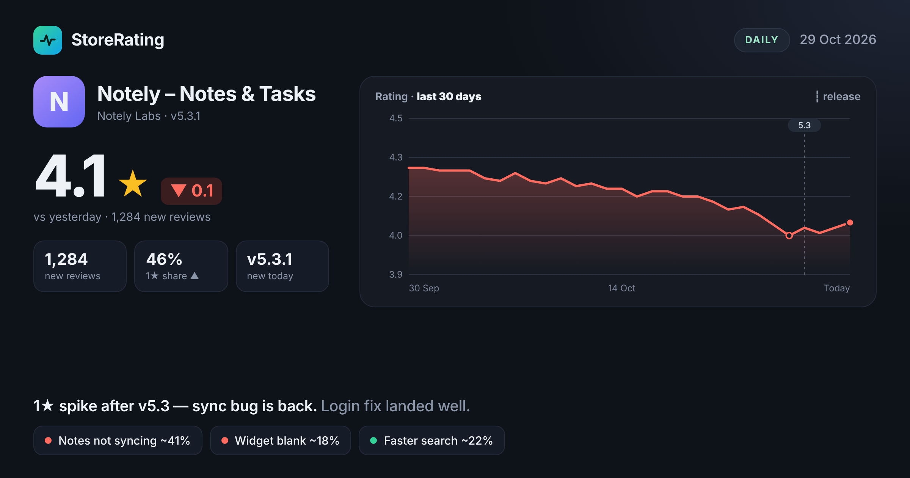

# StoreRating

[@storeratingbot](https://t.me/storeratingbot) is a free Telegram bot that watches Google Play apps and tells you what changed: rating moves, new releases, what users complain about, and sudden 1★ spikes.

Add your app and a few competitors, and get one image card per app every morning.



## What it does

- **Watch up to 10 apps** — send `/add` with a Play Store link or package name.
- **Daily update** at 11 AM in your timezone, one card per app, only when something changed.
- **Instant alerts** for new releases, rating drops, 1★ spikes and apps removed from the store.
- **Review themes** — top complaints and praise, summarised by Claude.
- **Monthly and quarterly reports** with longer trends.
- **Pause** everything or a single app anytime from `/apps`.

## Commands

| Command | What it does |
|---|---|
| `/add <link or package>` | Watch a new app |
| `/apps` | View, pause, resume or remove your apps |
| `/pause`, `/resume` | Pause or resume all notifications |
| `/settings` | Digest time and timezone |
| `/delete` | Delete all your data |

## How it works

| Part | Runs on |
|---|---|
| Bot webhook, admin dashboard, Stats API | Vercel (`web/`) |
| Daily job: fetch apps, Claude summaries, card rendering, sending | GitHub Actions (`job/`) |
| Database | Supabase Postgres, Row Level Security on every table |
| Review summaries | Claude Haiku 5.5, Batch API |

Work is done once per app and shared by every user watching it, so cost grows with the number of apps, not users. Store access sits behind a swappable Store Source contract (`contracts/`), so the scraper can be replaced without touching the rest of the code.

The full design, build steps and acceptance checks are in [PLAN.md](PLAN.md). Next work is in [ROADMAP.md](ROADMAP.md).

## Privacy

We store your Telegram chat ID, timezone, settings and watchlist. Nothing else: no names, no usernames, no phone numbers. `/delete` removes all of it.

Review text is processed to build summaries and then discarded. Reviewer names are never stored.

## Status

Code-complete and tested; launching once secrets and accounts are configured. See the Status section of [PLAN.md](PLAN.md).

## Running locally

```bash
pip install -r job/requirements.txt && python -m playwright install chromium
TEST_DATABASE_URL=postgresql://postgres@localhost/postgres python -m pytest   # Python, against a throwaway database
cd web && npm ci && npm test && npm run build                                # Web
STORE_SOURCE=stub DATABASE_URL=... python -m job.daily                      # dry run: no BOT_TOKEN means messages are printed
```

## Security

Found a vulnerability? See [SECURITY.md](SECURITY.md).

## License

[MIT](LICENSE) © 2026 Ayaz Qureshi

StoreRating is not affiliated with or endorsed by Google. Google Play is a trademark of Google LLC.
